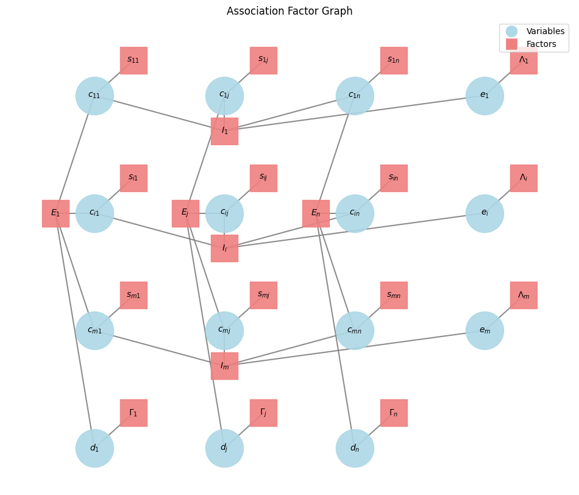
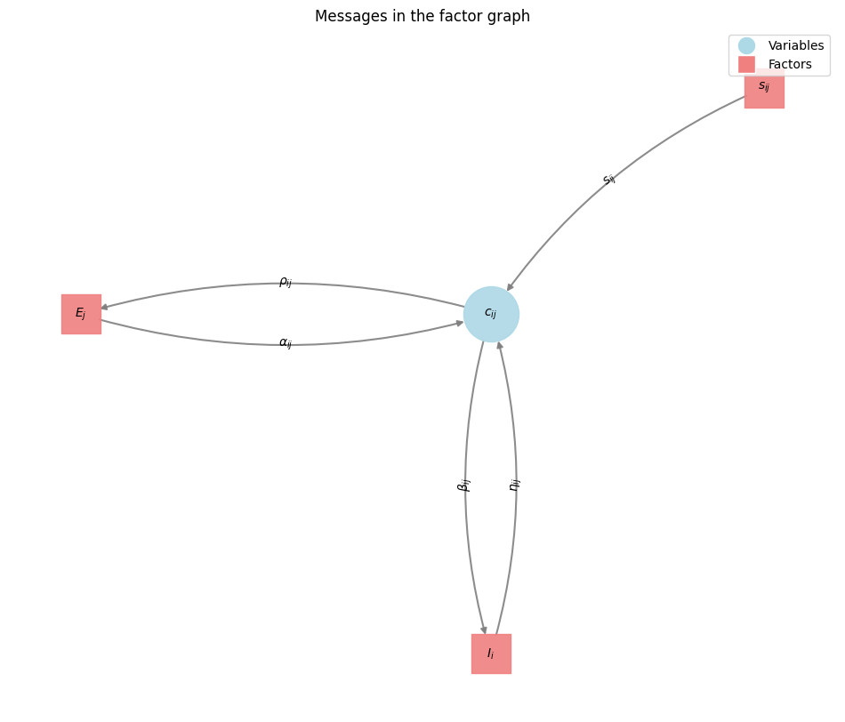
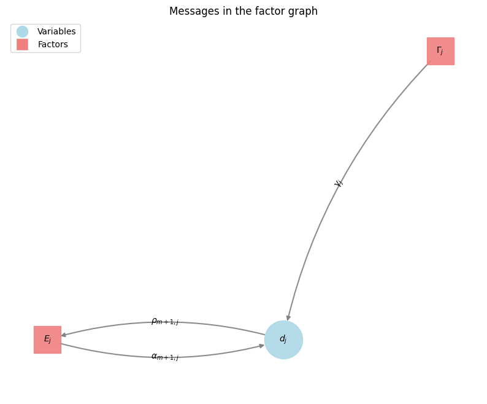
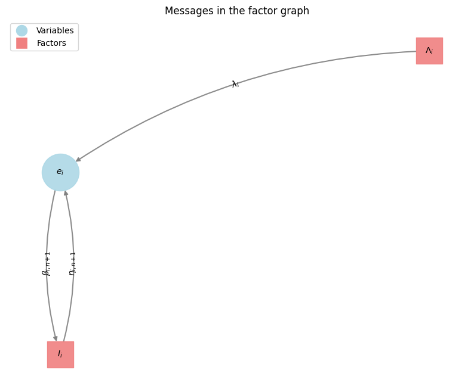
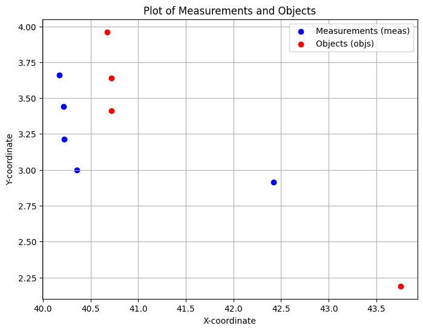
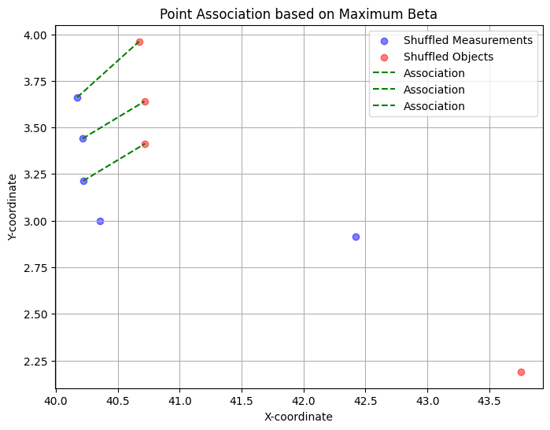

This article presents MASDA (Max-Sum Algorithm Data Association), a data association algorithm that passes messages on a factor graph.

I derived the formula presented here using the same binary-variable formulation as Givoni and Frey (2009):

> Givoni, I. E., & Frey, B. J. (2009). *A binary variable model for affinity propagation.* Neural Computation, 21(6), 1589–1600. [doi:10.1162/neco.2009.05-08-785](https://doi.org/10.1162/neco.2009.05-08-785)

I also compare MASDA with SPADA (Sum-Product Algorithm Data Association). Meyer et al. (2018) cover SPADA for multi-target tracking in detail:

> Meyer, F., Kropfreiter, T., Williams, J. L., Lau, R., Hlawatsch, F., Braca, P., & Win, M. Z. (2018). *Message passing algorithms for scalable multitarget tracking.* Proceedings of the IEEE, 106(2), 221–259. [doi:10.1109/JPROC.2018.2789427](https://doi.org/10.1109/JPROC.2018.2789427)

At the end is a worked Python implementation that executes the equations directly.

## Introduction

Data association is a fundamental problem in robotics, computer vision and autonomous systems. The task is to link incoming data — sensor measurements, say — to the entities or tracks that already exist.

**Example 1: Measurement-to-Object Association**

Consider a scenario in autonomous driving or surveillance where a vehicle is equipped with sensors — radar, lidar, a camera — that detect objects in its environment. At each time step, these sensors generate a set of 'measurements' – detections of potential objects. Simultaneously, the system maintains a set of 'objects' (or tracks) that it believes exist and is currently monitoring. The core challenge of measurement-to-object association is to decide, for each new measurement, which of four cases applies:

- it corresponds to an existing object;
- it is a new, previously unobserved object (a *birth*);
- an existing object was not detected in this scan (a *missed detection*, or *misdetection*);
- or the measurement is spurious (*clutter*).

For example, suppose a radar detects a blob at a certain position. The data association algorithm must decide whether this blob is the same car it measured in a previous scan, a newly appeared pedestrian, or sensor noise. Associating a new measurement with the wrong track causes track swapping: the system believes it is still following the original object while actually following a different one. In autonomous driving, that misleads downstream motion prediction.

**Example 2: Data Association in Simultaneous Localization and Mapping (SLAM)**

In SLAM, a mobile robot or agent builds a map of an unknown environment while simultaneously estimating its own position within that map. Get the association wrong and both the map and the robot's own position are wrong with it. A robot observes a feature with its sensors: a corner, a door, a landmark. It then has to decide whether that feature is already present in its growing map, or is a new one to be added. This is known as feature association or loop closure detection (when the robot revisits a previously mapped area).

Suppose the robot associates a newly observed feature with an existing map feature that is actually a different one. That introduces errors into both the map and its own estimated pose: duplicate features, and skewed map geometry. The opposite failure costs as much. If the robot does not recognise a feature it has seen before, it concludes it is somewhere new. The map then grows a second copy of a place it had already mapped.

Data association algorithms are also needed in other fields, such as medicine, statistics, biology, and weather forecasting, to name a few. The terminology differs in those fields. This article uses *measurements* and *detections* throughout, for the entities describing a state of the system perceived without prior knowledge from a previous scan. These might be raw measurements, such as positions, or already processed data, such as clusters and features. Objects describe an accumulated, maybe "learned" state or just a previous state of the system. The two words can also separate two sensors rather than two times. In a multi-sensor setup with overlapping fields of view, "measurements" may be the data from one sensor and "objects" the data from another.

Objects and measurements are considered throughout this article as independent and identically distributed (i.i.d.).

**Hungarian-Derived Algorithms**

Hungarian-derived algorithms are the classic methods for solving optimal assignment problems. The Munkres algorithm for the Assignment Problem is the usual example.

Data association can be framed as exactly that task: find a one-to-one mapping between two sets of items, minimising total cost or maximising total similarity. What rules these algorithms out is not accuracy but cost.

The standard Hungarian algorithm runs in $$O(N^3)$$ for $$N$$ items. A tracking or mapping problem routinely carries hundreds or thousands of potential associations. Cubic growth over that many, inside a frame budget and on an embedded processor, is what makes it unusable rather than merely slow.

**The Jonker-Volgenant Algorithm**

The Jonker-Volgenant Algorithm was developed to improve upon the Hungarian Algorithm and is now the preferred method for solving the Linear Assignment Problem (LAP) for large, square cost matrices. Both algorithms reach a theoretical worst-case time complexity of $$O(n^3)$$ in their improved versions. Here $$n$$ is the number of rows or columns of the cost matrix. The Jonker-Volgenant method was nevertheless designed to be practically faster.

## Factor Graphs for Data Association

Four properties of the factor graph matter for data association. Each property reduces the computational complexity of the solver rather than merely organising the notation.

**The decisions and the rules are separate nodes.** Variable nodes carry the decisions: whether measurement $$i$$ is associated with object $$j$$, and whether it is clutter instead. Factor nodes carry everything that scores or restricts those decisions: the similarity of a pair, and the rule that a measurement may be used once. Keeping them apart is what makes the other three properties possible.

**A new rule is a new factor, not a new algorithm.** Each factor is a local function over the variables it touches. To add a rule — that two objects cannot be arbitrarily close, say — you add a factor and derive the message it sends. The solver itself does not change. [Part 1 of the stereo series](https://www.mariolueder.com/2026-08-07-MASDA-for-Sparse-Stereo-Matching/#6-can-masda-express-the-ordering-constraint) does exactly this for the ordering constraint, and measures what it costs.

The factor graph below and the notation is used throughout this article.
    

    


**Every dependency is drawn.** Every decision connects to what scores it and to what restricts it. Each association decision $$c_{ij}$$, each clutter decision $$e_i$$ and each misdetection decision $$d_j$$ reaches its own similarity score, and the two exclusivity constraints $$I_i$$ and $$E_j$$. A rule the graph does not contain is a rule the solver cannot enforce, and the drawing is where you check which is which.

**Message passing runs directly on the structure.** Max-Sum, used in MASDA, and Sum-Product, used in SPADA, both work by sending local messages along the edges until the assignment stops changing. Each pixel's or measurement's preference reaches the rest of the graph through its neighbours, so a global assignment comes out of local arithmetic. The cost per iteration follows the number of *edges*, not the number of possible assignments.

Data association is inherently a combinatorial problem. Factor graphs and message-passing algorithms search that space without enumerating every possible assignment. What comes back is optimal on a tree, and on a loopy graph usually close to it.

The graph carries two kinds of term:

  * Unary potentials: Costs/similarities for individual assignments ($$S_{ij}$$), clutter ($$\Lambda_i$$), or misdetections ($$\Gamma_j$$).
  * High-order potentials and constraints: relationships involving several variables at once. The mutual exclusivity constraints $$I_i$$ and $$E_j$$ are the ones used here. $$I_i$$ ensures each measurement associates with at most one object or with clutter; $$E_j$$ ensures each object associates with at most one measurement or with a misdetection.

Depending on the message-passing algorithm used:

  * Max-Sum (MASDA) finds the maximum a posteriori assignment: the single most likely set of associations.
  * Sum-Product (SPADA) computes a marginal probability for each possible association. A consumer that needs to weigh an uncertain association rather than accept or reject it wants those numbers.

### SPADA (Sum Product Algorithm Data Association) and MASDA (Max-Sum Algorithm Data Association)

SPADA and MASDA run on the same factor graph — binary association variables $$c_{ij}$$, clutter variables $$e_i$$, misdetection variables $$d_j$$, similarity factors, and mutual exclusivity constraints — and differ only in the operator inside the factor-to-variable update:

1. **Variable-to-Factor Messages:** In the probability domain, a variable node sends the product of all incoming messages from its other connected factors. In the log-domain, that product becomes a sum.
2. **Factor-to-Variable Messages:** Combine the factor's own potential with the incoming messages from all other variables connected to that factor, then eliminate those other variables:
   - **SPADA (Sum-Product)** *sums* over the other variables (or uses `log-sum-exp` in the log-domain to prevent numerical underflow). Once messages settle, each variable's belief gives the marginal probability $$P(c_{ij}=1)$$, $$P(e_i=1)$$, or $$P(d_j=1)$$.
   - **MASDA (Max-Sum)** *maximises* over the other variables. Once messages settle, the beliefs identify the single most likely joint assignment (the MAP estimate).

Where several assignments are plausible, SPADA retains the uncertainty by assigning a probability in $$[0, 1]$$ to each candidate. That is the right output for multi-target trackers or SLAM back-ends that weight multiple hypotheses rather than committing to one. When a downstream consumer wants a single hard decision per measurement — as in stereo matching — MASDA finds it directly and avoids evaluating `log-sum-exp`.


## MASDA

MASDA is an iterative message-passing algorithm that finds the maximum a posteriori (MAP) assignment on the data association factor graph.

### Factor Graph Structure

The factor graph structure and the derivation below follow the binary-variable formulation in [Givoni and Frey (2009)](https://doi.org/10.1162/neco.2009.05-08-785).

**Variable Nodes** (circles — $$c_{ij}$$, $$e_i$$, $$d_j$$) represent the binary decisions to infer:

  * $$c_{ij} \in \{0, 1\}$$: whether measurement $$i$$ is associated with object $$j$$ ($$c_{ij}=1$$) or not ($$c_{ij}=0$$).
  * $$e_i \in \{0, 1\}$$: whether measurement $$i$$ is clutter or a newly born object (not associated with any existing object).
  * $$d_j \in \{0, 1\}$$: whether object $$j$$ is misdetected (not associated with any measurement).

**Factor Nodes** (squares — $$S_{ij}$$, $$\Lambda_i$$, $$\Gamma_j$$, $$I_i$$, $$E_j$$) encode the scores and constraints on those variables:

*Similarity Factors* ($$S_{ij}$$): encodes the log-likelihood or similarity score $$s(i,j)$$ of associating measurement $$i$$ with object $$j$$:

$$
S_{ij}(c_{ij})  =
\begin{cases}
    s(i,j),& \text{if } c_{ij} = 1\\
    0,              & \text{otherwise}
\end{cases}
$$

*Clutter Factors* ($$\Lambda_i$$): encodes the score $$\lambda(i)$$ of declaring measurement $$i$$ to be clutter:

$$
\Lambda_{i}(e_{i})  =
\begin{cases}
    \lambda(i),& \text{if } e_{i} = 1\\
    0,              & \text{otherwise}
\end{cases}
$$

*Misdetection Factors* ($$\Gamma_j$$): encodes the score $$\gamma(j)$$ of declaring object $$j$$ to be misdetected:

$$
\Gamma_{j}(d_{j})  =
\begin{cases}
    \gamma(j),& \text{if } d_{j} = 1\\
    0,              & \text{otherwise}
\end{cases}
$$

*Constraint Factors* ($$I_i$$ and $$E_j$$): enforce mutual exclusivity.

*Measurement Constraint Factors* ($$I_i$$): for each measurement $$i$$, enforces that $$i$$ is either associated with exactly one object or declared as clutter ($$e_i=1$$). The function $$I_i(c_{i1}, \dots, c_{iN}, e_i)$$ evaluates to $$-\infty$$ if $$e_i + \sum_j c_{ij} \neq 1$$, and to $$0$$ otherwise. In the log-domain a score of $$-\infty$$ is not a high-cost option, it is a forbidden one: no finite score can overcome it.

$$
I_{i}(c_{i1},\dots,c_{iN}, e_i)  =
\begin{cases}
    -\infty,& \text{if } e_i + \sum_j c_{ij} \neq 1\\
    0,              & \text{otherwise}
\end{cases}
$$

*Object Constraint Factors* ($$E_j$$): for each object $$j$$, enforces that $$j$$ is either associated with exactly one measurement or declared as misdetected ($$d_j=1$$). The function $$E_j(c_{1j}, \dots, c_{Mj}, d_j)$$ evaluates to $$-\infty$$ if $$d_j + \sum_i c_{ij} \neq 1$$, and to $$0$$ otherwise.


$$
E_{j}(c_{1j},\dots,c_{Mj},d_j)  =
\begin{cases}
    -\infty,& \text{if } d_j + \sum_i c_{ij} \neq 1\\
    0,              & \text{otherwise}
\end{cases}
$$

### Objective Function

MASDA seeks the assignment of all $$c_{ij}$$, $$e_i$$, and $$d_j$$ variables that maximises the total score $$\mathcal{S}$$:

$$
\mathcal{S}(\dots) = \sum_{i,j}S_{ij}(c_{ij}) + \sum_{j}\Gamma_{j}(d_{j}) + \sum_{i}\Lambda_{i}(e_{i}) + \sum_{i}I_{i}(c_{i1},\dots,c_{iN}, e_i) + \sum_{j}E_{j}(c_{1j},\dots,c_{Mj}, d_j)
$$

This objective sums the unary scores for associations, clutter, and misdetections, while $$I_i$$ and $$E_j$$ assign $$-\infty$$ to any configuration that violates one-to-one exclusivity.


### Message Passing (Max-Sum)

MASDA passes messages iteratively between the variable and factor nodes in the log-domain, where products become sums and marginalisation is replaced by maximisation.

**Variable-to-Factor Messages:** A variable node $$x$$ sends to factor node $$f$$ the sum of all messages arriving at $$x$$ from its other neighbouring factors:

$$
\mu_{x\rightarrow f}(x) = \sum_{f_l \in \text{ne}(x) \setminus \{f\}}\mu_{f_l\rightarrow x}(x)
$$

**Factor-to-Variable Messages:** A factor node $$f$$ sends a message to variable node $$x$$ in three steps:

1. Sum the incoming messages from the other variables connected to $$f$$, excluding $$x$$.
2. Add $$f$$'s own function value.
3. Maximise over all assignments of those other variables.

$$
\mu_{f\rightarrow x}(x) = \max_{x_1,\dots,x_M}\left[f(x, x_1, \dots, x_M) + \sum_{x_m \in \text{ne}(f) \setminus \{x\}} \mu_{x_m \rightarrow f}(x_m)\right]
$$











The message on a binary variable $$c_{ij}$$, $$e_i$$ or $$d_j$$ is a two-element vector, one score for state $$0$$ and one for state $$1$$. For a MAP estimate only the difference between the two states matters, because adding a constant to both leaves the argmax unchanged. Each message therefore reduces to a single scalar.

For example, the message from variable $$c_{ij}$$ to factor $$I_i$$ is denoted $$\beta_{ij}(m)$$ for $$m \in \{0,1\}$$:

$$
\beta_{ij}(m) = \mu_{c_{ij} \rightarrow I_i}(m)
$$

Its scalar message difference is

$$
\beta_{ij} = \beta_{ij}(1) - \beta_{ij}(0)
$$

The same scalar difference notation applies to $$\alpha_{ij}$$, $$\rho_{ij}$$, and $$\eta_{ij}$$.


### Variable-to-Factor Messages

Each variable-to-factor message is the sum of the incoming messages from the other factors connected to that variable.

To unify the notation, we write the clutter and misdetection variables as an extra column $$n+1$$ and an extra row $$m+1$$:

$$
\begin{aligned}
c_{i,n+1} &= e_i, & S_{i,n+1} &= \Lambda_i, & s(i,n+1) &= \lambda_i \\
c_{m+1,j} &= d_j, & S_{m+1,j} &= \Gamma_j,  & s(m+1,j) &= \gamma_j
\end{aligned}
$$

#### Message to $$I_i$$

For $$c_{ij} = 1$$:

$$
\begin{align}
\beta_{ij}(1) & = \mu_{c_{ij} \rightarrow I_i}(1) \\
& = \sum_{f_l \in \text{ne}(c_{ij}) \setminus \{I_i\}}\mu_{f_l\rightarrow c_{ij}}(1) \\
& = S_{ij}(1) + \alpha_{ij}(1)
\end{align}
$$

For $$c_{ij} = 0$$:

$$
\beta_{ij}(0) = S_{ij}(0) + \alpha_{ij}(0)
$$

Taking the difference gives the scalar message:

$$
\begin{align}
\beta_{ij} & = \beta_{ij}(1) - \beta_{ij}(0) \\
& = (S_{ij}(1) - S_{ij}(0)) + (\alpha_{ij}(1) - \alpha_{ij}(0)) \\
& = s(i,j) + \alpha_{ij} \\
\beta_{i,n+1} & = \lambda(i)
\end{align}
$$

#### Message to $$E_j$$

By symmetry along the column:

$$
\begin{align}
\rho_{ij}(1) & = S_{ij}(1) + \eta_{ij}(1) \\
\rho_{ij}(0) & = S_{ij}(0) + \eta_{ij}(0) \\
\rho_{ij} & = \rho_{ij}(1) - \rho_{ij}(0) \\
& = (S_{ij}(1) - S_{ij}(0)) + (\eta_{ij}(1) - \eta_{ij}(0)) \\
& = s(i,j) + \eta_{ij}\\
\rho_{m+1,j} & = \gamma(j)
\end{align}
$$

No message is sent back to the unary factor $$S_{ij}$$; it has degree one, so its outgoing message is always the prior score $$s(i,j)$$.

### Factor-to-Variable Messages

We now evaluate the factor-to-variable update for $$c_{ij} = 1$$ and $$c_{ij} = 0$$. Any configuration that violates a constraint evaluates to $$-\infty$$ and drops out of the maximum.


#### From $$I_i$$

Factor $$I_i$$ constrains row $$i$$ so that measurement $$i$$ is associated with exactly one object or declared as clutter.

When $$c_{ij} = 1$$ (measurement $$i$$ is associated with object $$j$$), every other variable $$c_{it}$$ in row $$i$$ must be $$0$$ for $$I_i$$ to evaluate to $$0$$:

$$
\begin{align}
\eta_{ij}(1) & = \mu_{I_i\rightarrow c_{ij}}(1) \\
& = \max_{c_{ik}, k \ne j}\left[I_i(c_{i1},\dots, c_{ij} = 1, \dots, c_{i,n+1}) + \sum_{t \ne j} \beta_{it}(c_{it}) \right] \\
& = \sum_{t \ne j} \beta_{it}(0)
\end{align}
$$

When $$c_{ij} = 0$$ (measurement $$i$$ is not associated with object $$j$$), exactly one other variable $$c_{ik}$$ ($$k \neq j$$) in row $$i$$ must be set to $$1$$, and all remaining variables in row $$i$$ must be $$0$$:

$$
\begin{align}
\eta_{ij}(0) & = \mu_{I_i\rightarrow c_{ij}}(0) \\
& = \max_{c_{ik}, k \ne j}\left[I_i(c_{i1},\dots, c_{ij} = 0, \dots, c_{i,n+1}) + \sum_{t \ne j} \beta_{it}(c_{it}) \right] \\
& = \max_{k \ne j}\left[\beta_{ik}(1) + \sum_{t \notin \{k,j\} } \beta_{it}(0) \right]
\end{align}
$$

Subtracting the two states cancels every term in the sum except $$t = k$$, leaving a single scalar reduction:

$$
\begin{align}
\eta_{ij} & = \eta_{ij}(1) - \eta_{ij}(0) \\
& = - (\eta_{ij}(0) - \eta_{ij}(1)) \\
& = - \max_{k \ne j}\left[\beta_{ik}(1) + \sum_{t \notin \{k,j\} } \beta_{it}(0) - \sum_{t \ne j} \beta_{it}(0) \right] \\
& = - \max_{k \ne j}\left[\beta_{ik}(1) - \beta_{ik}(0) \right] \\
& = - \max_{k \ne j}\beta_{ik}
\end{align}
$$

#### From $$E_j$$

Factor $$E_j$$ applies the same one-of-many constraint to column $$j$$, ensuring that object $$j$$ associates with at most one measurement.

When $$c_{ij} = 1$$:

$$
\begin{align}
\alpha_{ij}(1) & = \mu_{E_j\rightarrow c_{ij}}(1) \\
& = \max_{c_{kj}, k \ne i}\left[E_j(c_{1j},\dots, c_{ij} = 1, \dots, c_{m+1,j}) + \sum_{t \ne i} \rho_{tj}(c_{tj}) \right] \\
& = \sum_{t \ne i} \rho_{tj}(0)
\end{align}
$$

When $$c_{ij} = 0$$, exactly one other variable $$c_{kj}$$ ($$k \neq i$$) in column $$j$$ must be set to $$1$$:

$$
\begin{align}
\alpha_{ij}(0) & = \mu_{E_j\rightarrow c_{ij}}(0) \\
& = \max_{c_{kj}, k \ne i}\left[E_j(c_{1j},\dots, c_{ij} = 0, \dots, c_{m+1,j}) + \sum_{t \ne i} \rho_{tj}(c_{tj}) \right] \\
& = \max_{k \ne i}\left[\rho_{kj}(1) + \sum_{t \notin \{k,i\} } \rho_{tj}(0) \right]
\end{align}
$$

Taking the scalar difference cancels the common sum in the same way:

$$
\begin{align}
\alpha_{ij} & = \alpha_{ij}(1) - \alpha_{ij}(0) \\
& = - (\alpha_{ij}(0) - \alpha_{ij}(1)) \\
& = - \max_{k \ne i}\left[\rho_{kj}(1) + \sum_{t \notin \{k,i\} } \rho_{tj}(0) - \sum_{t \ne i} \rho_{tj}(0) \right] \\
& = - \max_{k \ne i}\left[\rho_{kj}(1) - \rho_{kj}(0) \right] \\
& = - \max_{k \ne i}\rho_{kj}
\end{align}
$$

#### From $$S_{ij}$$

The scalar message sent from the unary factor $$S_{ij}$$ is the similarity score $$s(i,j) = S_{ij}(1) - S_{ij}(0)$$.


## Summary

Collecting the six scalar equations derived above:

$$
\begin{align}
\beta_{ij} & = s(i,j) + \alpha_{ij} \\
\beta_{i,n+1} & = s(i,n+1)  = \lambda_i \\
\rho_{ij} & = s(i,j) + \eta_{ij} \\
\rho_{m+1,j} & = s(m+1,j) = \gamma_j \\
\eta_{ij} & = - \max_{k \ne j}\beta_{ik} \\
\alpha_{ij} & = - \max_{k \ne i}\rho_{kj}
\end{align}
$$

### Combined Update

Substituting $$\alpha_{ij}$$ and $$\eta_{ij}$$ into $$\beta_{ij}$$ and $$\rho_{ij}$$ eliminates two of the four message arrays, leaving one alternating pair of updates:

$$
\begin{align}
\beta_{ij} & = s(i,j) - \max_{k \ne i}\rho_{kj} \\
\rho_{ij} & = s(i,j) - \max_{k \ne j}\beta_{ik}
\end{align}
$$

### The Belief

The belief at a variable node is the sum of all incoming messages arriving at that node:

$$
\mu_{x}(x) = \sum_{f_l \in \text{ne}(x)}\mu_{f_l\rightarrow x}(x)
$$

For an association between measurement $$i$$ and object $$j$$:

$$
b_{ij} = \alpha_{ij} + \eta_{ij} + s(i,j) = \beta_{ij} + \rho_{ij} - s(i,j)
$$

For measurement $$i$$ being clutter or a newly born object:

$$
b_{i,n+1} = \eta_{i,n+1} + \lambda_{i}
$$

For object $$j$$ being misdetected:

$$
b_{m + 1, j} = \alpha_{m+1, j} + \gamma_{j}
$$


### Iterative Process

The messages $$\beta$$ and $$\rho$$ are updated alternately for a fixed number of iterations or until they settle. Each iteration subtracts the best competing alternative along the row and along the column, propagating local similarity scores and one-to-one exclusivity across the graph.


### Final Beliefs and Assignment

After message passing, each variable's belief sums the evidence from both directions. Choosing the highest-belief option per row yields the binary associations, clutter declarations, and misdetected objects.

That decode is MASDA's output. It reaches a global assignment by passing local preferences and exclusivity constraints along the edges, and remains an approximation because the factor graph contains four-cycles.

### Computational Complexity: MASDA vs. Jonker-Volgenant

The Jonker-Volgenant (JV) algorithm solves the Linear Assignment Problem (LAP) to proven optimality in $$O(N^3)$$ time, where $$N$$ is the dimension of the cost matrix after augmenting it with clutter and misdetection rows and columns.

MASDA is an approximate inference algorithm on a loopy factor graph. It is neither guaranteed to reach the exact MAP optimum nor guaranteed to converge, and in practice it runs for a fixed number of iterations $$T$$.

In a dense association graph with $$M$$ measurements and $$N$$ objects, each message update needs the maximum over a row or column excluding one entry. Because the "max excluding $$j$$" for an entire line only requires finding the line's largest and second-largest values, one iteration over a dense matrix takes $$O(M \cdot N)$$ operations, and $$T$$ iterations take $$O(T \cdot M \cdot N)$$. When candidate gating restricts the graph to $$E \ll M \cdot N$$ plausible edges, passing messages only along existing edges reduces the complexity to $$O(T \cdot E)$$.

*When to use which:*

- For a pure one-to-one Linear Assignment Problem of moderate size, Jonker-Volgenant gives the exact optimum.
- MASDA is the better choice in three situations:
  - the graph is sparse ($$E \ll M \cdot N$$) and $$T$$ is small, where $$O(T \cdot E)$$ is much faster than $$O(N^3)$$ ([Part 1 of the stereo series](https://www.mariolueder.com/2026-08-07-MASDA-for-Sparse-Stereo-Matching/#5-speed-the-representation-decides-it) measures a 20× speed-up in Python before any compiled code);
  - clutter and misdetection are carried directly as scalar thresholds inside the row and column reductions rather than by augmenting the matrix;
  - additional pairwise constraints — such as geometric ordering or spatial smoothness — couple two associations, which turns the problem into one an assignment solver cannot express at all.

### Computational Complexity: MASDA vs. SPADA

Both SPADA and MASDA pass messages on the same factor graph and share the same asymptotic complexity per iteration. SPADA requires more work per edge because marginalisation evaluates `log-sum-exp` (exponentials and logarithms) across every row and column, whereas MASDA only tracks the two largest values via scalar comparisons.

## Implementation

The implementation below is written for readability rather than speed. The naive nested loops below take $$O(M \cdot N^2)$$ per iteration because they re-scan each row and column; caching the top two values per line reduces that to $$O(M \cdot N)$$, and storing only plausible edges reduces it to $$O(E)$$.

The synthetic example below places five measurements and four objects in a 2D plane. Three of the measurements cluster near three objects in the upper left, where nearest-neighbour Euclidean distance would assign multiple measurements to the same object. Each measurement may associate with at most one object or be declared clutter; each object may associate with at most one measurement or be declared misdetected.

### Includes
```python
import numpy as np
import torch
import random
import os
import matplotlib.pyplot as plt
import sys
```

### Measurements and Objects

```python
# Measurements
points = torch.tensor([
    [40.1732, 3.66123],
    [40.2158, 3.43958],
    [40.2211, 3.21301],
    [40.3561, 2.99893],
    [42.4198, 2.91224],
])

points = torch.t(points)
meas_x = points[0,:]
meas_y = points[1,:]

# Objects
objs = torch.tensor([
    [40.7211, 3.41301],
    [40.7158, 3.63958],
    [40.6732, 3.96123],
    [43.7526, 2.19003]
])

objs = torch.t(objs)
objs_x = objs[0,:]
objs_y = objs[1,:]

# plot the measurements meas and the objects

plt.figure(figsize=(8, 6)) # Create a new figure for clarity
plt.scatter(meas_x.numpy(), meas_y.numpy(), label='Measurements (meas)', color='blue')
plt.scatter(objs_x.numpy(), objs_y.numpy(), label='Objects (objs)', color='red')
plt.xlabel('X-coordinate')
plt.ylabel('Y-coordinate')
plt.title('Plot of Measurements and Objects')
plt.legend()
plt.grid(True)
plt.show()
```
    

    

### Shuffle the measurements and objects

```python
# Get the number of measurements and objects
num_measurements = meas_x.shape[0]
num_objects = objs_x.shape[0]

# Create shuffled indices for measurements and objects
shuffled_meas_indices = torch.randperm(num_measurements)
shuffled_objs_indices = torch.randperm(num_objects)

# Shuffle the measurements and objects using the shuffled indices
shuffled_meas_x = meas_x[shuffled_meas_indices]
shuffled_meas_y = meas_y[shuffled_meas_indices]

shuffled_objs_x = objs_x[shuffled_objs_indices]
shuffled_objs_y = objs_y[shuffled_objs_indices]
```

### Compute a distance matrix using the shuffled measurements

```python
# Reshape shuffled measurements and objects for broadcasting
shuffled_meas = torch.stack((shuffled_meas_x, shuffled_meas_y), dim=1)
shuffled_objs = torch.stack((shuffled_objs_x, shuffled_objs_y), dim=1)

# Or use the unshuffled order so the printed matrix below is deterministic:
shuffled_meas = torch.stack((meas_x, meas_y), dim=1)
shuffled_objs = torch.stack((objs_x, objs_y), dim=1)

# Compute the squared difference in x and y coordinates
diff_x = shuffled_meas[:, None, 0] - shuffled_objs[None, :, 0]
diff_y = shuffled_meas[:, None, 1] - shuffled_objs[None, :, 1]


# Compute the squared Euclidean distance
dist_sq = diff_x**2 + diff_y**2

# Take the square root to get the Euclidean distance matrix
#distance_matrix = -torch.sqrt(dist_sq)
distance_matrix = -dist_sq

# distance_matrix = torch.cat((distance_matrix, torch.ones(num_measurements, 1) * -2.), dim=1) # column for clutter
# distance_matrix = torch.cat((distance_matrix, torch.ones(1, num_objects + 1) * -2.), dim=0) # row for misdetections

print("Distance Matrix:")
distance_matrix
```

    Distance Matrix:


    tensor([[ -0.3618,  -0.2949,  -0.3400, -14.9766],
            [ -0.2560,  -0.2900,  -0.4813, -14.0703],
            [ -0.2900,  -0.4267,  -0.7642, -13.5180],
            [ -0.3047,  -0.5398,  -1.0266, -12.1906],
            [ -3.1364,  -3.4326,  -4.1510,  -2.2979]])


### MASDA - iteration and compute the belief

```python
# both beta and rho matrices are initialized with a large positive value (1e+3)
# for all their elements. In the context of the Max-Sum algorithm, where
# messages represent scores or preferences, initializing with a large positive
# value like this often serves as a 'neutral' or 'uninformative' starting point.
# It essentially means that, initially, there is no strong preference for any
# particular association (or non-association) based on prior messages.
beta = torch.ones(distance_matrix.shape) * 1e+3
rho = torch.ones(distance_matrix.shape) * 1e+3
n_meas_assoc = distance_matrix.shape[0]
n_obj_assoc = distance_matrix.shape[1]

# Define the constant costs/scores for misdetection and clutter.
# These represent the prior belief or preference for an object to be misdetected
# or a measurement to be clutter/newly born.
misdetection = -1.0
clutter = misdetection


# print("n_objs:", n_obj_assoc)
# print("n_points:", n_meas_assoc)
# print("n_objs:", num_objects)
# print("n_points:", num_measurements)

# Damping factor to stabilize message updates, especially in loopy graphs.
# A value of 0.0 means no damping (messages are fully replaced each iteration).
# A value closer to 1.0 would mean messages change slowly (weighted average of old and new).
damping = 0.0

# Initialize belief matrix. It will store the final scores for each possible assignment,
# including clutter and misdetection cases.
belief = torch.ones((n_meas_assoc + 1, n_obj_assoc + 1)) * misdetection

# Function to compute the final beliefs after message passing.
# The belief for each assignment (measurement i to object j, clutter, or misdetection)
# is the sum of relevant incoming messages and the similarity score.
def compute_belief():
    # Iterate through each measurement to calculate its association beliefs
    for i in range(num_measurements):
        # Mask for object-specific calculations: ensures we don't consider
        # the current object's own message when calculating max for alpha.
        # This large value effectively 'removes' the current element from max operations
        # by making it so large that it will never be selected.
        mask_meas = torch.zeros(n_meas_assoc)
        mask_meas[i] = 1.e+20

        # Calculate beliefs for measurement-to-object associations
        for j in range(num_objects):
            # Mask for measurement-specific calculations: similar to mask_meas but for beta.
            mask_obj = torch.zeros(n_obj_assoc)
            mask_obj[j] = 1.e+20
            # eta_ij = -max_{k!=j} beta_ik (message from I_i to c_ij)
            # It represents the penalty if measurement 'i' were associated with 'j',
            # considering alternatives to 'j'.
            eta = - torch.max(torch.max(beta[i,:] - mask_obj), torch.tensor(clutter))
            # alpha_ij = -max_{k!=i} rho_kj (message from E_j to c_ij)
            # It represents the penalty if object 'j' were associated with 'i',
            # considering alternatives to 'i'.
            alpha = - torch.max(torch.max(rho[:,j] - mask_meas), torch.tensor(clutter))
            # The belief for associating measurement 'i' with object 'j' is the sum of
            # these two messages and the direct similarity score.
            belief[i,j] = eta + alpha + distance_matrix[i,j]

    # Calculate beliefs for measurements being clutter (new born object)
    for i in range(num_measurements):
        j = num_objects # This represents the 'clutter' column
        # eta_i,n+1 = -max_{k} beta_ik (message from I_i to e_i)
        # It represents the penalty if measurement 'i' is clutter, considering all object alternatives.
        eta = - torch.max(beta[i,:])
        # Belief for measurement 'i' being clutter is this message plus the clutter cost.
        belief[i,j] = eta + clutter

    # Calculate beliefs for objects being misdetected
    for j in range(num_objects):
        i = num_measurements # This represents the 'misdetection' row
        # alpha_m+1,j = -max_{k} rho_kj (message from E_j to d_j)
        # It represents the penalty if object 'j' is misdetected, considering all measurement alternatives.
        alpha = - torch.max(rho[:,j])
        # Belief for object 'j' being misdetected is this message plus the misdetection cost.
        belief[i,j] = alpha + misdetection

    # print("Belief:\n", belief)
    # print(torch.sum(belief))

# Main message passing loop
for iter in range(6):
   # Update beta messages (variable to factor I_i)
   for i in range(num_measurements):
        # Create a mask to exclude the current measurement's own message when calculating
        # the maximum over rho_kj in the beta update.
        mask = torch.zeros(n_meas_assoc)
        mask[i] = 1.e+20 # Large value to ensure it's not chosen by torch.max

        for j in range(num_objects):
            # Beta update: beta_ij = s(i,j) - max_{k!=i} rho_kj
            # max_val here computes max_{k!=i} rho_kj or clutter
            max_val = torch.max(torch.max(rho[:,j] - mask), torch.tensor(clutter))
            # Apply damping to the message update
            beta[i,j] = beta[i,j] * damping + (distance_matrix[i,j] - max_val) * (1. - damping)

   # Update rho messages (variable to factor E_j)
   for j in range(num_objects):
        # Create a mask to exclude the current object's own message when calculating
        # the maximum over beta_ik in the rho update.
        mask = torch.zeros(n_obj_assoc)
        mask[j] = 1.e+20 # Large value to ensure it's not chosen by torch.max

        for i in range(num_measurements):
            # Rho update: rho_ij = s(i,j) - max_{k!=j} beta_ik
            # max_val here computes max_{k!=j} beta_ik or misdetection
            max_val = torch.max(torch.max(beta[i,:] - mask), torch.tensor(misdetection))
            # Apply damping to the message update
            rho[i,j] = rho[i,j] * damping + (distance_matrix[i,j] - max_val) * (1. - damping)

   # print rho and beta
   # print("beta: ", beta)
   # print("rho: ", rho)

# Recompute beliefs after message passing
compute_belief()
# print(belief)
```

### Plot the association

```python
# get the maximum index from beta and plot the point association using this information

beta_misdetection = torch.cat((beta, torch.ones(num_measurements, 1) * misdetection), dim=1) # column for clutter
# distance_matrix = torch.cat((distance_matrix, torch.ones(1, num_objects + 1) * -2.), dim=0) # row for misdetections

beta_misdetection = belief
# print(beta_misdetection)

# Get the index of the maximum value in beta
max_beta_index = torch.argmax(beta_misdetection,1)
# print(max_beta_index)

# Convert the linear index to row and column indices
row_index = range(num_measurements)
col_index = max_beta_index

# print(f"Maximum value of beta is at index: ({row_index}, {col_index})")

# Extract the associated points from the shuffled measurements and objects
associated_measurement = shuffled_meas[row_index]

# print(f"Associated Measurement Point:\n{associated_measurement.numpy()}")
# print(f"Associated Object Point:\n{associated_object.numpy()}")

# Plot the associated points and a line connecting them
plt.figure(figsize=(8, 6))
plt.scatter(shuffled_meas_x.numpy(), shuffled_meas_y.numpy(), label='Shuffled Measurements', color='blue', alpha=0.5)
plt.scatter(shuffled_objs_x.numpy(), shuffled_objs_y.numpy(), label='Shuffled Objects', color='red', alpha=0.5)
for i in range(num_measurements):
    if max_beta_index[i] < num_objects:
        plt.plot([shuffled_meas[i][0].numpy(), shuffled_objs[max_beta_index[i]][0].numpy()],
            [shuffled_meas[i][1].numpy(), shuffled_objs[max_beta_index[i]][1].numpy()],
                color='green', linestyle='--', label='Association')

plt.xlabel('X-coordinate')
plt.ylabel('Y-coordinate')
plt.title('Point Association based on Maximum Beta')
plt.legend()
plt.grid(True)
plt.show()
```


    

### Discussion

The hypothesis is a sensible one. The top-left measurements go to the top-left objects. The other two measurements have no object anywhere near them and stay unassociated, which leaves the bottom-right object undetected.

The computation of the similarities is too simplistic here to be considered a real-world example. One would incorporate uncertainties. Further, with objects and measurements streaming from a radar or a lidar, detection probabilities and clutter probabilities belong in the model too. Both come from functions describing what the sensor can do and what the environment constrains.
